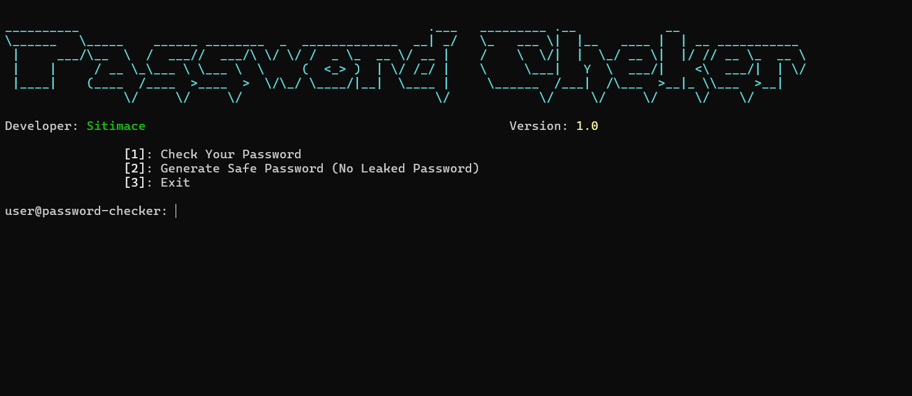

# Password Checker

A Python command-line tool that checks whether a password has appeared in known data breaches and creates random passwords verified against the same data.



## Features

- **Password check:** Shows how many times a password has appeared in known leaks. Your input stays hidden as you type.
- **Password generator:** Creates a random password using your chosen length, digits, and special characters, then checks it against the same database before displaying it.
- **Privacy:** Your password and its complete hash stay on your machine (see below).
- **Secure randomness:** Passwords are generated using Python’s `secrets` module.

## Installation

Requires Python 3.8 or newer and an internet connection.

```bash
git clone https://github.com/SitimaceSSH/Password-Checker.git
cd Password-Checker
pip install -r requirements.txt
```

## Usage

```bash
python main.py
```

| Option | Description |
|--------|-------------|
| `1` | Check a password against known leaks |
| `2` | Generate a password that hasn’t appeared in any known leak |
| `3` | Exit |

Run the tool in a regular terminal. Hidden input (`getpass`) may not work in some IDE consoles.

## How it works

Leak data comes from the [Have I Been Pwned](https://haveibeenpwned.com/Passwords) Pwned Passwords range API, which uses k-anonymity:

1. The password is hashed locally with SHA-1 (for example, `password` becomes `5BAA61E4C9B93F3F0682250B6CF8331B7EE68FD8`).
2. Only the first five characters of the hash (`5BAA6`) are sent to the API.
3. The API returns leaked hash suffixes that match that prefix, along with their occurrence counts.
4. The remaining 35 characters are compared locally with the returned list.

Because many hashes share the same five-character prefix, the server can’t tell which password you checked.

The generator creates candidate passwords with `secrets`, checks each one the same way, and discards any that appear in a leak.
